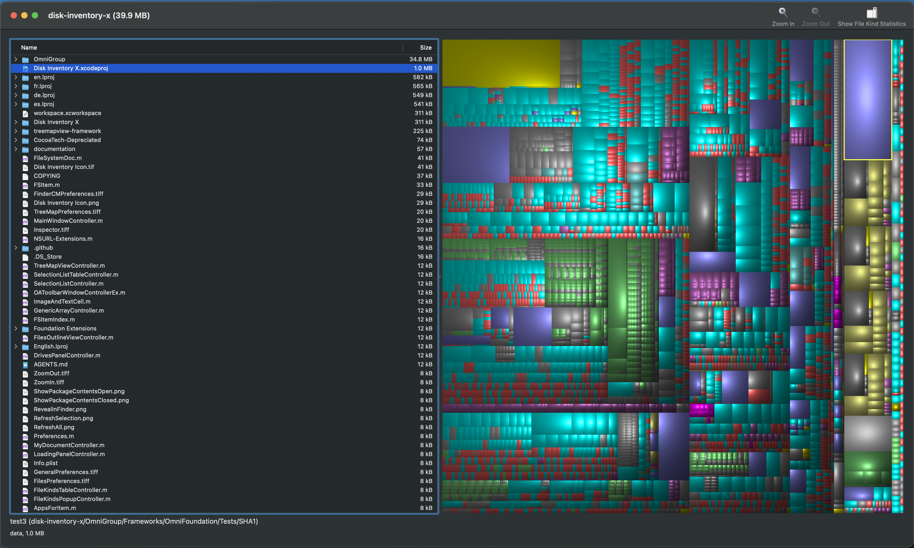

# Disk Inventory X



Disk Inventory X is a macOS disk-usage visualizer. It scans a folder or volume and presents the results as a treemap, alongside outline and statistics views that help identify what is consuming space.

## Highlights

- Visual treemap for exploring disk usage
- Document-based Cocoa app built around `FileSystemDoc` and `FSItem`
- Side panels for file outlines, file kinds, selection lists, and volume information
- Localized UI resources in multiple `.lproj` bundles
- GPL v3 licensed

## Requirements

- macOS
- Xcode
- Git submodules:
  - `OmniGroup`
  - `treemapview-framework`

## Getting started

Clone the repository and initialize the submodules:

```sh
git submodule update --init --recursive
```

Open the workspace in Xcode:

```sh
open workspace.xcworkspace
```

## Building

Build the main app from Xcode using the `Disk Inventory X` scheme, or from the command line:

```sh
xcodebuild -workspace workspace.xcworkspace \
  -scheme "Disk Inventory X" \
  -configuration Debug \
  -destination 'generic/platform=macOS' \
  CODE_SIGNING_ALLOWED=NO \
  CODE_SIGNING_REQUIRED=NO \
  CODE_SIGN_IDENTITY="" \
  build
```

## Release builds

The repository includes a release helper script:

```sh
./BuildRelease.sh
```

That script runs the Xcode release build for the app target.

## Repository layout

- `AppController.{h,m}` - application entry point and delegate
- `FileSystemDoc.{h,m}` - document model and file tree scanner
- `FSItem.{h,m}` - file-system tree node model
- `MainWindowController.{h,m}` - main window controller
- `TreeMapViewController.{h,m}` - treemap integration
- `Preferences.{h,m}` and `PrefsPanelController.{h,m}` - preferences system
- `FilesOutlineViewController.{h,m}` - file outline view
- `FileKindsTableController.{h,m}` - file kind statistics
- `SelectionListController.{h,m}` - selection list panel
- `DrivesPanelController.{h,m}` - volumes panel
- `InfoPanelController.{h,m}` - inspector panel
- `documentation/` - release notes, screenshots, and notes

## Notes

- The project uses Objective-C with a small amount of C.
- The app relies on OmniGroup frameworks and TreeMapView via submodules.
- The main project is `Disk Inventory X.xcodeproj`, but the workspace is the easiest way to build and browse the app.

## Releases

Prebuilt releases are available on GitHub:

https://github.com/RandyMcMillan/disk-inventory-x/releases
